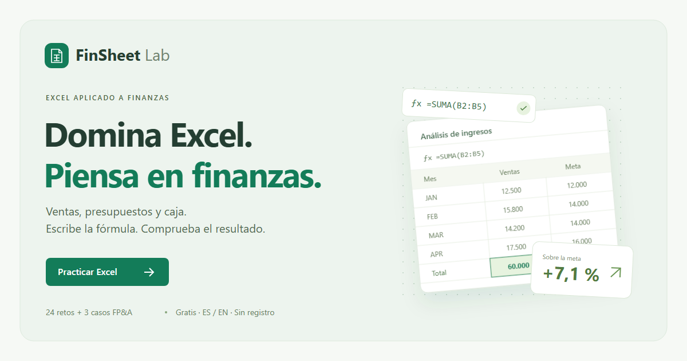
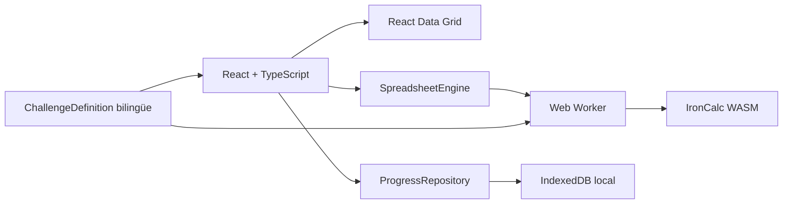

# FinSheet Lab

**Aprende Excel. Piensa en finanzas. / Master Excel. Think in finance.**

Laboratorio gratuito y bilingüe de práctica financiera: 24 retos, seis áreas y tres casos de FP&A. Escribes fórmulas en una hoja interactiva, compruebas resultados y continúas tu ruta sin crear una cuenta.

[Demo pública / Live demo](https://finsheet-lab.pages.dev) · [Código / Source](https://github.com/EsauCarvajal/finsheet-lab)



## Español

### Ejecutar y verificar

Requiere **Node 24.14.1** (declarado en `.nvmrc`) y npm. El archivo de bloqueo fija las dependencias; no necesitas Excel, claves de API ni servicios de pago.

```bash
npm ci
npm run dev
```

Abre la URL local que imprime Vite. Para comprobar el resultado de producción:

```bash
npm test
npm run build
npm run test:install
npm run test:e2e
npm run preview
```

`test:install` descarga Chromium, Firefox y WebKit en `.cache/browsers`, fuera del repositorio. Las pruebas de navegador levantan la vista previa de producción en el puerto 4173. En Linux, instala también las dependencias de sistema con `npx playwright install-deps` si son necesarias. El flujo de GitHub Actions ya lo contempla.

### Qué incluye

- 24 retos: dos básicos, uno intermedio y uno avanzado por módulo.
- Fundamentos, lógica, agregaciones, búsquedas, texto/fechas y funciones financieras.
- Tres casos: presupuesto frente a ejecución, caja a seis meses y evaluación de inversión.
- Español e inglés con selectores independientes para interfaz y fórmulas.
- Portada breve; catálogo, casos y progreso en pantallas propias. El temario y las ayudas se despliegan bajo demanda.
- Selector de idioma con botones y navegación por flechas, Home y End; menú móvil con cierre por Escape.
- Dos pistas por reto, soluciones explicadas, estados de resolución asistida, puntos sin duplicados y siete insignias.
- Borradores, intentos y resultados en IndexedDB; exportación/importación JSON hasta 1 MB.
- Diseño adaptable y edición por teclado en la hoja (doble clic/F2, Enter, Tab y flechas).

### Arquitectura



- `src/content`: catálogo versionado, datos sintéticos, requisitos pedagógicos y soluciones de referencia.
- `src/engine`: normalización nativa ES/EN, funciones permitidas, evaluación y protocolo del Worker.
- `src/storage`: persistencia, validación de respaldos, puntos y recomendaciones.
- `src/components`: experiencia de práctica; `src/App.tsx` contiene navegación, catálogo y progreso.
- `tests`: validación independiente de cálculos, contenido, progreso y recorridos en tres motores de navegador.

La UI no conoce detalles de IronCalc. `SpreadsheetEngine` permite sustituir el motor; `ProgressRepository` permite añadir sincronización más adelante. El catálogo usa IDs estables y versión por actividad. Una versión incompatible de respaldo se rechaza explícitamente, conservando el estado actual: los cambios de contenido requieren una migración antes de incrementar versiones.

### Cómo se corrige

La respuesta debe ser una fórmula, no un número escrito a mano. Se calcula con los datos originales y con dos o más conjuntos alternativos deterministas. Se comparan resultados por celda y tolerancia numérica, aceptando fórmulas equivalentes. El reto de referencias absolutas también verifica `$B$2` mediante los tokens del motor. Los casos requieren una interpretación correcta de los datos originales.

Las fórmulas de referencia y las pruebas alternativas viajan al navegador. Esto es deliberado: la plataforma enseña; no es un sistema de evaluación adversarial ni una certificación verificable. Un usuario controla su almacenamiento local y puede modificar sus puntos.

IronCalc traduce funciones y separadores preservando los textos entre comillas. Los códigos OPS, SALES, OK, REVIEW, YES y MISSING son invariantes entre idiomas para mantener los criterios de búsqueda. La interfaz traduce los encabezados; los identificadores internos se conservan. Los valores se comparan con precisión completa y se formatean solo al mostrarse.

### Criterio financiero

- Importes sintéticos en unidades monetarias (UM/CU), sin datos personales ni empresas reales.
- Margen bruto: `(ventas − costo) / ventas`.
- Desviación presupuestal: `real − presupuesto`; en gastos, una desviación positiva es sobrecosto.
- La proyección de caja acumula cobros y pagos, distinguiendo liquidez de utilidad.
- PAGO/PMT usa tasa anual **nominal** dividida entre 12; no supone una tasa efectiva anual.
- VNA/NPV excluye el flujo inicial: este se suma fuera de la función. TIR/IRR incluye el flujo inicial negativo.
- Los casos usan flujos periódicos convencionales. Una TIR o un VAN favorable no elimina riesgos ni garantiza proyecciones.

### Seguridad y privacidad

No hay servidor de aplicación, inicio de sesión, cookies de seguimiento ni analítica de terceros. Cálculo y progreso permanecen en el dispositivo. El proveedor de alojamiento puede procesar registros de acceso como parte de su infraestructura.

Las fórmulas se interpretan con IronCalc, nunca con `eval` ni `new Function`. El Worker permite solo las funciones del temario, entradas de hasta 512 caracteres, un máximo de 180 tokens y referencias A1:Z99 en una sola hoja. Las referencias externas, fórmulas matriciales y funciones de acceso a red se rechazan. Un límite de 10 segundos termina y recrea el Worker ante bloqueos. Las entradas se renderizan como texto y los respaldos se validan con Zod antes de reemplazar estado.

`public/_headers` configura CSP, restricciones de permisos, protección contra incrustación y MIME sniffing. CSP permite `wasm-unsafe-eval` para compilar WebAssembly, pero bloquea la evaluación dinámica de JavaScript. Se permite estilo inline por los estilos de posicionamiento de la cuadrícula; scripts inline siguen bloqueados. Comprueba que el alojamiento aplique los encabezados: `vite preview` no simula `_headers`.

El progreso depende del origen y perfil del navegador. Borrar datos, usar otro dominio o terminar una sesión privada puede eliminarlo. Exporta un respaldo antes de cambiar de equipo o dominio. Si IndexedDB falla, la sesión continúa en memoria y puedes exportarla; no se muestra una garantía de persistencia en ese caso.

### Publicar gratis en Cloudflare Pages

1. Crea un repositorio público con este código y conéctalo a Cloudflare Pages, o usa publicación directa.
2. En Pages configura: comando `npm run build`, salida `dist`, Node `24.14.1`. La integración Git actualiza la web cuando se publica código en la rama elegida.
3. Usa el subdominio gratuito `pages.dev`. Un dominio propio es opcional y tendría costo.

Publicación directa desde una cuenta autorizada:

```bash
npx wrangler login
npx wrangler pages project create finsheet-lab --production-branch main --force
npm run build
npm run deploy -- --branch main
```

El flag `--force` solo se usa al crear el proyecto para seleccionar Pages estático con la versión fijada de Wrangler; las publicaciones posteriores no lo necesitan. Si el nombre no está disponible, cámbialo de forma consistente en `wrangler.jsonc` y en el script `deploy`. No escribas tokens en el código. Para metadatos absolutos de Open Graph, genera la compilación con `SITE_URL=https://tu-sitio.pages.dev`.

Las visitas sirven archivos estáticos; no se utilizan Pages Functions ni servicios con facturación por uso. El objetivo es $0 de infraestructura con las condiciones actuales del plan gratuito, sujetas a sus límites y posibles cambios del proveedor. El resultado `dist` es portable a otro alojamiento estático.

### Añadir ejercicios y evolucionar

Añade una `ChallengeDefinition` con texto ES/EN, dos pistas, datos semilla, celdas objetivo, fórmulas de referencia, tolerancias y al menos dos variantes. Agrega una expectativa numérica independiente para nuevos conceptos financieros. El build comprueba el catálogo con Zod y las pruebas recorren todas las soluciones.

Mantén los IDs y versiones cuando solo corrijas texto. Si cambia la estructura de un reto, implementa una migración para borradores y respaldos. Las funciones nuevas deben incorporarse a la lista permitida y probarse con IronCalc antes de crear el contenido.

La evolución comercial propuesta prioriza talleres, acompañamiento y casos para empresas. Contenido premium protegido, cuentas o certificaciones requerirán validación en servidor y un presupuesto independiente. No se pueden proteger secretos o cobros mediante un muro de pago implementado únicamente en JavaScript público.

Materiales para difusión: `docs/LINKEDIN.md`, capturas en `artifacts` e imagen `public/social-preview.png`. `npm run capture` regenera las capturas con la vista previa levantada; `npm run social-image` regenera la imagen social desde un SVG propio.

### Verificación de lanzamiento

La revisión del 10 de octubre de 2026 incluye 67 pruebas de cálculo, contenido, Worker y respaldos, y 69 recorridos de navegador en Chromium, Firefox y WebKit. Los recorridos resuelven las 27 actividades, verifican las siete insignias y comprueban teclado, idiomas independientes, respaldos anteriores, almacenamiento bloqueado y conservación de borradores sin pulsar Enter. Se revisan anchos de 320, 390, 768, 1024 y 1440 píxeles, junto con auditorías automáticas de accesibilidad en ambos idiomas. Consulta el alcance en [docs/TESTING.md](docs/TESTING.md).

`node scripts/verify-deployment.mjs` comprueba la demo publicada, navegación, cambio de idioma, cálculo, persistencia, CSP, metadatos sociales y ausencia de solicitudes a terceros. La revisión npm no reportó vulnerabilidades conocidas en esa fecha; conviene repetirla al actualizar dependencias.

## English

FinSheet Lab is a free, bilingual Excel practice lab for aspiring financial analysts. It contains **24 challenges across six modules and three integrated FP&A cases**, with immediate feedback, a recommended learning path, freely accessible practice, points, badges and browser-local progress.

### Run and verify

Use Node **24.14.1**. Run `npm ci` and `npm run dev`. For a production verification, run `npm test`, `npm run build`, `npm run test:install` and `npm run test:e2e`. Playwright tests Chromium, Firefox and WebKit against the production preview. The GitHub Actions workflow performs the same checks.

### Design and calculation

React/TypeScript and React Data Grid provide the interface. IronCalc 0.8.4 runs in a Web Worker and translates formulas natively between Spanish and English. Interface and formula languages are independent. Stable data codes preserve quoted lookup criteria across languages.

The landing page keeps the introduction brief. Challenges, cases and progress have separate screens; the syllabus, concepts and worksheet help expand on request. Language buttons support arrows, Home and End. The mobile menu closes with Escape and restores focus.

`ChallengeDefinition` separates bilingual educational content from the UI. `SpreadsheetEngine` abstracts calculation and grading. `ProgressRepository` abstracts local persistence. Answers are checked against original inputs and multiple deterministic input variants with per-target tolerances. Valid alternative formulas are accepted; constants are rejected. Absolute references are required where they are the learning objective. Integrated cases also require correct financial interpretation.

### Financial conventions

All data is fictional and amounts are in currency units. Expense variance is actual minus budget. Cash flow uses receipts and payments, not accounting profit. PMT uses a nominal annual rate divided by 12. NPV discounts future period-end flows and adds the initial outlay separately; IRR includes the initial negative flow. Favorable results do not guarantee projected cash flows or remove investment risk.

### Privacy, security and limitations

There are no accounts, third-party analytics, AI APIs or application servers. Progress and calculations stay on the device; infrastructure providers may process access logs. IndexedDB saves drafts and activity; JSON backups transfer progress between devices. Clearing browser data or changing origins may erase progress. Storage failure leaves an in-memory session with export available.

The formula engine does not use JavaScript evaluation. Inputs, tokens, ranges and execution time are bounded; network functions and external references are blocked. Rendering treats user input as text. Backups are validated before replacement. Deployment headers restrict script origins, embedding and permissions while allowing WebAssembly compilation. Scores and solutions are locally controlled and do not constitute verifiable certification.

This educational simulator supports the curriculum’s functions, not all Excel capabilities. It does not include macros, Power Query, pivot tables, spreadsheet uploads or multiplayer. Content-version changes require an explicit progress migration.

### Deployment and future development

The output `dist` is a portable static site. Cloudflare Pages can build with `npm run build`, publish `dist` and use its free `pages.dev` subdomain. Direct deployment uses `npx wrangler login`, project creation and `npm run deploy -- --branch main`. A Cloudflare account is required. Optional custom domains and future server features can incur costs; provider free-tier conditions may change.

New challenges need bilingual copy, hints, reference solutions and input variants. The public core is MIT-licensed. Workshops, mentoring and corporate cases are potential future revenue sources; protected premium content and verified assessments require a separate backend.

The October 10, 2026 verification includes 67 unit tests and 69 browser journeys across Chromium, Firefox and WebKit. Coverage includes all 27 activities, badges, keyboard interaction, legacy backups, independent language settings, unsubmitted drafts, five viewport widths and automated accessibility scans in both languages. See [docs/TESTING.md](docs/TESTING.md) for scope. Run `node scripts/verify-deployment.mjs` to verify production navigation, headers, social metadata and browser-local calculation/persistence. npm reported no known vulnerabilities at release; repeat the audit when dependencies change.

## License / Licencia

MIT. See `LICENSE` and `THIRD_PARTY_NOTICES.md`. Excel is a Microsoft trademark; this project is independent and is not affiliated with Microsoft.
